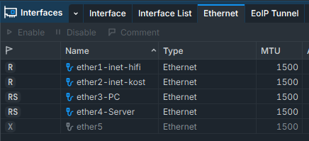
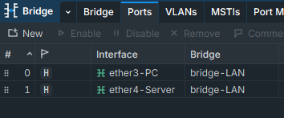
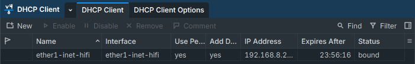
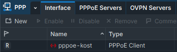
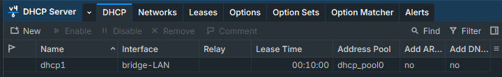
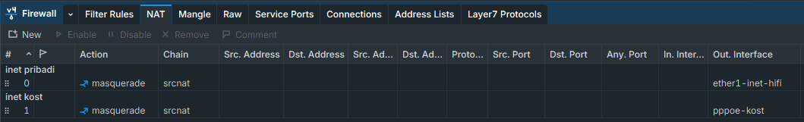

# Mikrotik
### \[UNUSED\] Installing Mikrotik CHR on Vultr (Using Cloudflared Now)
Please refer to this page for mikrotik on vultr https://www.vultr.com/docs/configure-a-mikrotik-chr-router-with-a-virtual-private-cloud-vpc/.

### Basic Security Configuration
This configuration applied on both mikrotik (local and cloud).

```routeros
# Password
/password
# Remove/disable admin and create new user
/user add name=leon password=<your_strong_password> group=full
/user remove admin
# Disable unused service port (api might be opened again).
/ip service disable telnet,ftp,www,www-ssl,api,api-ssl
# Change ssh port
/ip service set ssh port=2209
# Disable neighbor discovery
/ip neighbor discovery-settings set discover-interface-list=none 
# Disable unused interface
/interface set x disabled=yes 
```

Lately our public cloud router bruteforced by random people, in that case we need Bruteforce prevention. This configuration will prevent a SSH and FTP brute forcer to be banned for 10 days after repetitive attempts and put them on the table of shame.

```routeros
/ip firewall filter
# FTP
add chain=input protocol=tcp dst-port=21 src-address-list=ftp_blacklist action=drop \
comment="drop ftp brute forcers"

add chain=output action=accept protocol=tcp content="530 Login incorrect" dst-limit=1/1m,9,dst-address/1m

add chain=output action=add-dst-to-address-list protocol=tcp content="530 Login incorrect" \
address-list=ftp_blacklist address-list-timeout=3h

# SSH
add chain=input protocol=tcp dst-port=2209 src-address-list=ssh_blacklist action=drop \
comment="drop ssh brute forcers" disabled=no

add chain=input protocol=tcp dst-port=2209 connection-state=new \
src-address-list=ssh_stage3 action=add-src-to-address-list address-list=ssh_blacklist \
address-list-timeout=10d comment="" disabled=no

add chain=input protocol=tcp dst-port=2209 connection-state=new \
src-address-list=ssh_stage2 action=add-src-to-address-list address-list=ssh_stage3 \
address-list-timeout=1m comment="" disabled=no

add chain=input protocol=tcp dst-port=2209 connection-state=new src-address-list=ssh_stage1 \
action=add-src-to-address-list address-list=ssh_stage2 address-list-timeout=1m comment="" disabled=no

add chain=input protocol=tcp dst-port=2209 connection-state=new action=add-src-to-address-list \
address-list=ssh_stage1 address-list-timeout=1m comment="" disabled=no
```

### Network Configuration
After security is done, Let's set network configuration, it's mostly set on `WinBox`.

#### Interfaces
So First, Go to `Interfaces` then set the ethernet that we want to use and disable unused port.



Next go to `Bridge`, then create a bridge to group the interface, in this case both interface shared some simmilar settings (`ether3` & `ether4`).



#### Get Internet Access
Then, set DHCP Client. This config is necessary because we need to get the IP from Internet Providers in order to access the internet. Go to `IP > DHCP Client`, then create New, choose the interface to `ether1`.



Because `ether2` using PPPoE to get access to the internet, so go to `PPP > Interface > New > PPPoE Client`, set a `Name` to `pppoe-kost` on `General` Tab, and set `User & Password` on `Dial Out` Tab.



Next, go to `IP > DNS`, and then set `Servers` to `1.1.1.1, 1.0.0.1`. You know what it is and don't ask me why I choose this 🫪 and don't forget to check `Allow Remote Requests` so all devices that connected trough mikrotik will get the same DNS.

#### DHCP Server
- In order to give connected device on `bridge-LAN` an IP, we need to set a `DHCP Server`. First we need an `IP Range`, to create that go to `IP > Address`, create New Address. Set address to `10.10.10.1/24` and set Interface to `bridge-LAN`.
- Then go to `IP > DHCP Server > DHCP Setup` set interface to `bridge-LAN`.



#### NAT
To share Internet accross the device (`bridge-LAN`). We need a masquerade NAT, to create that go to `IP > Firewall > NAT`. Create 2 `NAT`. Just set `Chain = srcnat`, for Personal Internet set `Out. Interface = ether1` and for Kost Internet set `Out. Interface = pppoe-kost`, then for `Action` set to `masquerade`.



> [!Note]
> Thats it for now. Due to the big gap between pppoe and my own personal internet. PCC (Per-Connection Classifier) method become unstable and sometimes causing timeout. So I decided to dig a bit more. Stay tunned!

### DNS Server
Add a Mikrotik firewall rule that forces all LAN devices to direct all DNS queries to the Mikrotik DNS server.

```routeros
ip firewall nat add chain=dstnat action=redirect to-ports=53 protocol=udp dst-port=53 to-address=<internal-ip-addrs> comment="DIRECT ALL DNS REQUESTS TO MIKROTIK INTERNAL DNS SERVER."
```

### Enabling REST API
In Winbox, Go to **IP \> Services**. Then enable **www-ssl** and set the Availability to our subnet.


Then, open terminal and test it.

```bash
curl -k -u <our_user>: https://mikrotik.playground.lokal/rest/system/resource
Enter host password for user '<our_user>':
{"architecture-name":"mmips","board-name":"hEX","build-time":"2024-06-07 12:49:11","cpu":"MIPS 1004Kc V2.15","cpu-count":"4","cpu-frequency":"880","cpu-load":"4","factory-software":"6.46.3","free-hdd-space":"4415488","free-memory":"204107776","platform":"MikroTik","total-hdd-space":"16777216","total-memory":"268435456","uptime":"2d11h36m31s","version":"7.15.1 (stable)","write-sect-since-reboot":"6410","write-sect-total":"1036240"}
```

### Backup & Restore
It's actually prety straight forward, you can check it here https://citraweb.com/artikel_lihat.php?id=71

### References
* \[UNUSED\] https://www.vultr.com/docs/configure-a-mikrotik-chr-router-with-a-virtual-private-cloud-vpc/
* https://billysoftacademy.com/how-to-use-a-mikrotik-router-as-a-dns-server-and-add-static-dns-records-for-internal-servers-in-your-lan-network/
* https://wiki.mikrotik.com/wiki/Manual:Securing_Your_Router
* https://wiki.mikrotik.com/wiki/Bruteforce_login_prevention
* https://help.mikrotik.com/docs/display/ROS/REST+API#RESTAPI-GET
