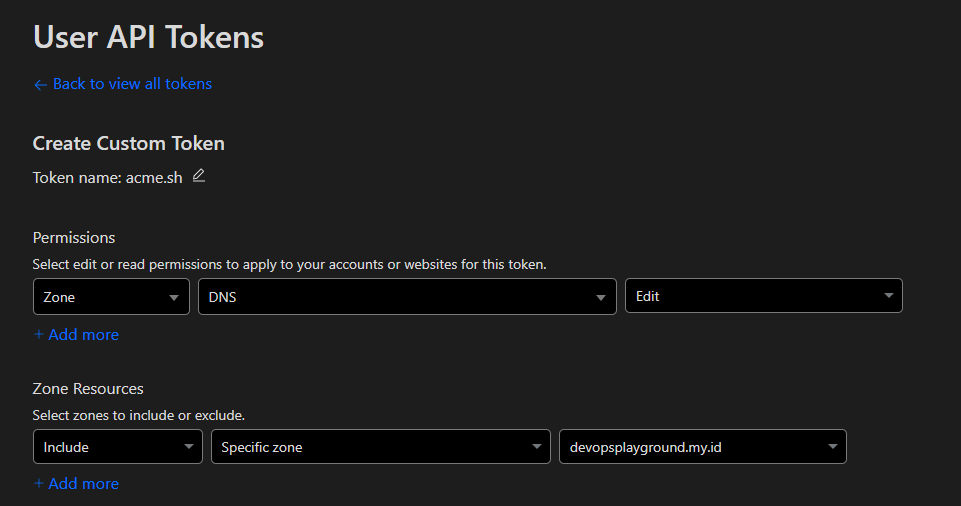
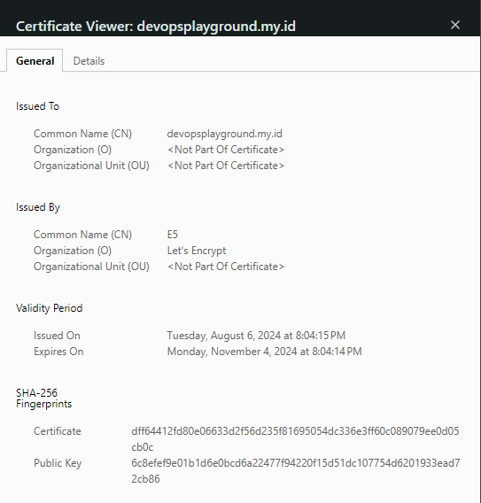

## Nginx

Installation of nginx

```bash
sudo apt install nginx
```

Actually... Nothing special on nginx, I just want to mention, all configuration will stored at `/etc/nginx/conf.d/...`.

Prepare configuration for enabling SSL. For example create config named `foo.conf` .

```
server {
   listen   443;
   server_name  foo.devopsplayground.my.id;

   ssl on;
   ssl_certificate      /etc/ssl/devopsplayground.my.id/fullchain.pem;
   ssl_certificate_key  /etc/ssl/devopsplayground.my.id/key.pem;
...
```

Actually again... Better save the configuration file at `sites-available` directory, and when the sites really want to enabled, just make a link from `sites-available to sites-enabled` .

```
sudo ln -s /etc/nginx/sites-available/foo.conf /etc/nginx/sites-enabled
```

## **\[UNUSED\] Let's Encrypt (Certbot)**

We can use https in the private environment. The idea is, generating wildcard cert using dns challenge and use it on every server.

```bash
# Install certbot
sudo apt install letsencrypt

# Generate wildcard cert using dns challenge
sudo certbot certonly --manual --preferred-challenges=dns --email youremail@blahblah.com --agree-tos -d *.yoursite.com
```

We'll be prompted to add the required DNS `CNAME` record to the DNS configuration for your domain.

```bash
...
Output from acme-dns-auth.py:
Please add the following CNAME record to your main DNS zone:
_acme-challenge.your-domain CNAME a15ce5b2-f170-4c91-97bf-09a5764a88f6.auth.acme-dns.io.

Waiting for verification...
```

In this case we use Cloudflare. After adding record on Cloudflare, press **Enter** at terminal. And your certificates will stored at `/etc/letsencrypt/live/`**`<yoursite>` .**

### Note on Certbot

```
NEXT STEPS:
- This certificate will not be renewed automatically. Autorenewal of --manual certificates requires the use of an authentication hook script (--manual-auth-hook) but one was not provided. To renew this certificate, repeat this same certbot command before the certificate's expiry date.
```

## Acme.sh

Support Let's Encrypt and Cloudflare API Token. And most importantly acme.sh support auto renewal with dns challenge.

First create API Token on Cloudflare, grant permission only can Edit DNS and specific Zone (domain you want to manage).



Confirm your configuration, and save CF Token, we'll use that later.

### Install acme.sh

Install acme.sh using git clone method.

```bash
# It's recommended to use root user.
sudo -i
cd /tmp
git clone https://github.com/acmesh-official/acme.sh.git
cd /tmp/acme.sh
./acme.sh --install -m my@example.com
```

### Issue your cert

By default acme.sh use ZeroSSL provider, but we can choose the SSL provider such as Let's Encrypt by specifying `--server`.

```bash
# Set your CF Token at Environment Variable
export CF_Token="Your_Cloudflare_DNS_API_Key_Goes_here"

# Issue your cert
acme.sh --issue --dns dns_cf -d devopsplayground.my.id -d '*.devopsplayground.my.id' --server letsencrypt

# Check your cert
acme.sh --list
```

### Install your cert

This will copying your cert to desired directory.

```bash
# Create specific directory to manage your cert
mkdir /etc/ssl/devopsplayground.my.id

# Install your cert, and reload service (any service that used cert)
acme.sh -d devopsplayground.my.id \
--install-cert --key-file /etc/ssl/devopsplayground.my.id/key.pem \
--fullchain-file /etc/ssl/devopsplayground.my.id/fullchain.pem \
--reloadcmd "systemctl reload teleport"
```

### Check crontab

```bash
crontab -l
44 19 * * * "/root/.acme.sh"/acme.sh --cron --home "/root/.acme.sh" > /dev/null
```

## Check SSL on Browser



## **References**

* https://www.avanet.com/en/kb/how-to-create-a-lets-encrypt-wildcard-certificate/
* https://github.com/acmesh-official/acme.sh/wiki
* https://www.cyberciti.biz/faq/issue-lets-encrypt-wildcard-certificate-with-acme-sh-and-cloudflare-dns/