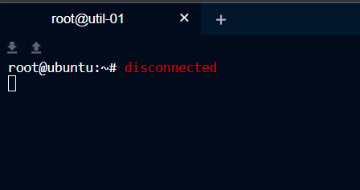
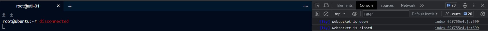

# Teleport
### Install Teleport UI

### Add semi-permanent token

Too lazy to create new token every time joining cluster, so create token with **999999h** ttl.

```bash
sudo tctl tokens add --type=node --ttl=999999h

# Check existing token
sudo tctl tokens ls
Token                            Type Labels Expiry Time (UTC)
-------------------------------- ---- ------ ----------------------------------
REDACTED                         Node        11 Jul 38 08:00 UTC (998699h58m6s)
```

Will expired at 11 Jul 2038 lol.

### \[If Using Nginx\] Reverse Proxy issue

If we left Teleport console idle for 1 minute, it will disconnected (in this case, I don't event configuring TTL on teleport itself).



After 2 hours of troubleshooting, I found at browser console that show **Websocket is closed.**

This will relate to [nginx websocket behavior](http://nginx.org/en/docs/http/websocket.html) that will close connection after 60 seconds. The solution is pretty simple, we just need to add `proxy_read_timeout` at nginx configuration.

### Reverse Proxy References

* http://nginx.org/en/docs/http/ngx_http_proxy_module.html#proxy_read_timeout
* https://github.com/gravitational/teleport/discussions/26445